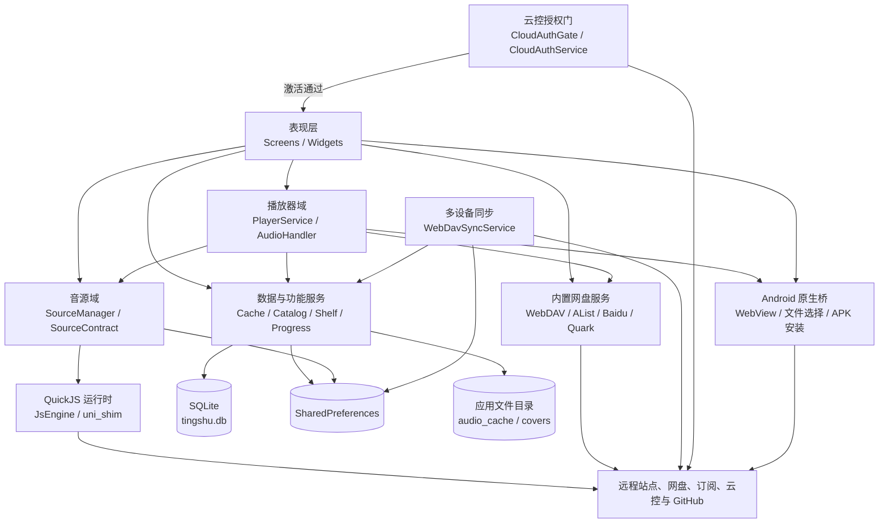
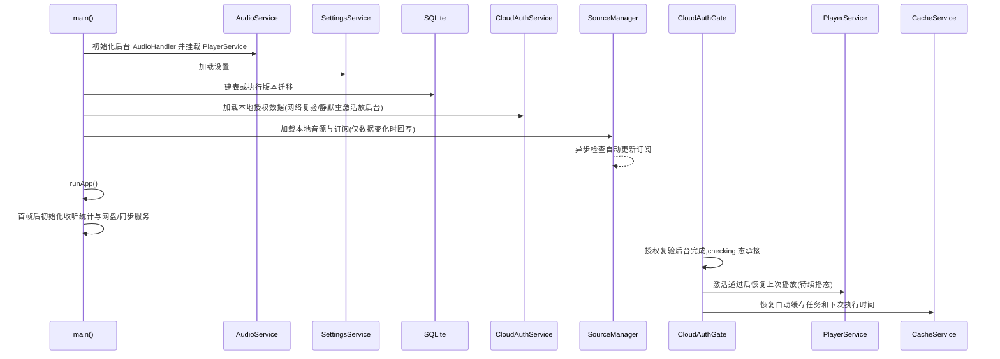
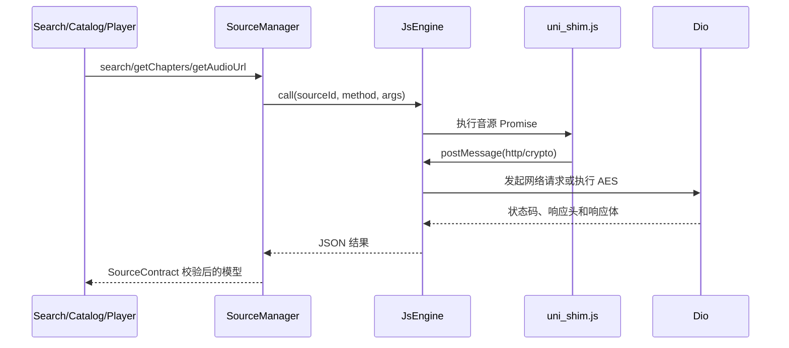

# 橘听软件架构

本文档描述橘听 Flutter 客户端当前的代码结构、核心数据流、持久化方案和扩展边界。文档对应 `1.3.0+11`（2026-09），以仓库中的实际实现为准。

## 1. 架构目标

橘听是一个 Android 优先的有声书播放器，主要解决以下问题：

- 使用统一 JavaScript 音源协议适配不同站点。
- 支持单源搜索、聚合搜索、书架和播放历史。
- 支持后台播放、断点续播、定时关闭和媒体通知控制。
- 将目录、播放进度和缓存索引持久化到 SQLite。
- 支持普通音频和 HLS 分片的自动缓存。
- 将 WebDAV、AList、百度网盘和夸克网盘作为内置书库能力接入。
- 通过邀请码云控完成激活与设备绑定。
- 基于 WebDAV 进行加密的多设备数据同步（书架、进度、设置、音源）。
- 通过公开发行仓库提供 Android 应用内更新。

当前项目采用轻量分层架构：页面负责交互，单例 Service 负责业务状态和外部系统接入，SQLite 与 SharedPreferences 负责本地持久化。项目没有引入完整的依赖注入或 Clean Architecture 框架。

## 2. 总体架构



## 3. 代码目录

| 目录 | 职责 |
| --- | --- |
| `lib/screens/` | 页面和用户交互，包括搜索、书架、目录、播放器、设置、网盘与更新页面。 |
| `lib/widgets/` | 可复用 UI，目前主要是封面组件和全局 MiniPlayer。 |
| `lib/player/` | 播放状态机、just_audio 封装、后台媒体通知和锁屏控制。 |
| `lib/source/` | 音源模型、协议校验、订阅管理、QuickJS 桥接、加密能力和调试器。 |
| `lib/data/` | SQLite、缓存、书架、进度、设置、日志、主题、网盘和更新服务。 |
| `assets/js/` | QuickJS 的 `uni` 兼容层。 |
| `assets/sources/` | 音源开发和转换产物；正式用户音源通过订阅下发，不作为 APK 内置源。 |
| `android/app/src/main/kotlin/` | Android WebView、文件选择、音频嗅探、后台保护和 APK 安装桥。 |
| `cloud-control/` | 云控服务端（Cloudflare Worker）：邀请码授权、设备绑定、管理后台和私有 R2 音源订阅部署。 |
| `test/` | Flutter 单元测试及 JavaScript 音源冒烟测试。 |
| `.github/workflows/` | arm64 发行包构建和公开发行仓库发布流程。 |

## 4. 分层职责

### 4.1 表现层

`HomeShell` 使用 `IndexedStack` 保留四个一级页面的状态：

1. 发现
2. 搜索
3. 书架
4. 设置

MiniPlayer 位于一级页面和底部导航之间，因此切换页面时持续存在。页面通过调用 Service 执行业务操作，并通过以下方式刷新 UI：

- `ChangeNotifier`：低频、跨组件状态。
- `ValueNotifier`：播放位置、缓冲位置、MiniPlayer 元信息等高频或细粒度状态。
- 页面内部 `setState`：加载状态、筛选条件和临时交互状态。

### 4.2 应用服务层

应用服务大多使用 `ClassName.instance` 单例。这样可以让播放器、媒体通知、MiniPlayer 和页面共享同一份状态，但也意味着服务之间存在直接依赖。

主要服务：

| 服务 | 主要职责 |
| --- | --- |
| `PlayerService` | 播放上下文、播放状态机、断点续播、错误恢复、定时关闭、自动切集。 |
| `SourceManager` | 音源安装、排序、启停、配置、订阅同步和统一接口路由。 |
| `CacheService` | 后续章节缓存、HLS 缓存、任务恢复、缓存清理和缓存索引。 |
| `CatalogCacheService` | 目录分页写入、元数据读取和 SQLite 窗口查询。 |
| `ShelfService` | 收藏书架。 |
| `ProgressService` | 播放进度和历史记录。 |
| `SettingsService` | 用户设置及缓存策略。 |
| `ThemeService` | 根据当前播放封面生成 Material 3 明暗配色。 |
| `LogService` | 内存运行日志，供诊断页面查看和复制。 |
| `CloudAuthService` | 邀请码激活、设备绑定、授权状态维护与掉激活静默重激活。 |
| `WebDavSyncService` | 基于 WebDAV 的加密多设备同步（书架、进度、设置、音源）。 |
| `ListeningStatsService` | 收听时长统计（累计与当日）。 |
| `AppUpdateService` | 检查 `version.json`、下载更新包并校验 SHA256。 |

### 4.3 集成层

集成层封装外部技术和平台能力：

- `Dio`：HTTP 请求和文件下载。
- `flutter_js`：QuickJS 音源执行环境。
- `just_audio`：音频加载、播放、进度和缓冲状态。
- `audio_service`：后台播放、通知栏、锁屏和耳机控制。
- Android `MethodChannel`：Flutter 无法直接完成的系统能力。
- `sqflite`：结构化业务数据。
- `shared_preferences`：设置、订阅、非敏感轻量配置。
- `flutter_secure_storage`：凭据加密存储（Android Keystore / EncryptedSharedPreferences），承载网盘 Cookie、WebDAV 账号、同步密码、云控令牌与邀请码。
- `pointycastle`：同步数据加密（AES-CBC + HMAC + PBKDF2）和音源通用 AES 解密。

## 5. 应用启动流程



首帧前只保留播放器、设置、数据库、授权本地数据与音源加载；收听统计、四个网盘与 WebDAV 同步在首帧后初始化（保持 WebDAV 先于同步的顺序，同步首次迁移依赖书库配置）。授权复验与掉激活静默重激活均为后台执行，弱网不再阻塞启动。各初始化步骤独立捕获异常并写入运行日志，单个非关键模块初始化失败不会直接阻止 App 启动。续播上下文与自动缓存任务的恢复由 `CloudAuthGate` 在激活通过后触发，未激活时不恢复。

## 6. 音源系统

### 6.1 统一协议

音源是运行在 QuickJS 中的 JavaScript 对象，核心接口为：

```text
search(keyword, page, pageSize)
getChapters(bookId, page, pageSize)
getAudioUrl(chapterId)
```

音源负责将站点差异转换为统一的 `Book`、`Chapter`、`SearchResult`、`CatalogResult` 和 `AudioResult`。App 不应针对单个站点增加搜索或解析分支。

`SourceContract` 在 Dart 边界完成以下校验：

- 必填字段和返回类型校验。
- 音源协议版本兼容性检查。
- 搜索和目录分页字段归一。
- 同一页重复书籍或章节 ID 去重。
- 音频 URL 的 HTTP/HTTPS 合法性检查。

### 6.2 QuickJS 桥接



QuickJS 侧通过 `uni.request` 发起请求；Dart 侧执行实际网络访问。通用 AES-CBC 解密由 `SourceCrypto` 和 `pointycastle` 提供，避免每个音源自行实现密码学算法。

### 6.3 登录、配置和嗅探

音源只有在声明登录地址或配置字段后，管理页面才显示登录与设置入口。Android 内置 WebView 返回 Cookie 或指定的 localStorage 值，随后写入音源配置。

当 `getAudioUrl` 返回嗅探请求时，`SniffService` 打开 `AudioSnifferActivity`，监听网页网络请求并返回符合音频规则的 URL 和请求头。

**信任模型**：音源代码运行在与宿主同进程的 QuickJS 中，通过受控桥接（`uni.request`/crypto）访问网络与通用解密能力，**当前不是权限沙箱**。配套的信任边界措施：

- 音源在 Dart 边界经过 `SourceContract` 严格校验，无法绕过协议直接操作 App 状态。
- 音源导入（本地/粘贴/链接）与订阅添加前有第三方风险确认对话框。
- 每笔音源外联请求记录在 `SourceNet` 日志（仅 scheme/host/path 与状态码，不含 query，防止令牌泄漏），运行日志页可按源审计外联行为。
- 网盘 Cookie、WebDAV 密码、订阅令牌、云控令牌等宿主凭据存于 Keystore 加密存储（`SecureStore`），音源无法读取；但音源自身的登录 Cookie 仍保存在 `audio_sources` 配置内（SharedPreferences），属于已知边界。

### 6.4 订阅

订阅 JSON 保存版本号和音源 URL。同步过程如下：

1. 下载订阅 JSON。
2. 根据相对或绝对 URL 下载 JS。
3. 加载 JS 并验证元数据和协议版本。
4. 更新本地 `audio_sources` 和订阅元数据。
5. 音源代码发生变化时清理对应目录缓存。

本地仅保存订阅地址、版本和下载后的 JS 文本，不保留独立的订阅文件。自动更新通过远端版本字符串与本地版本字符串是否不同来判断。

## 7. 搜索与目录

### 7.1 搜索

搜索页支持当前源搜索和聚合搜索：

- 聚合模式为每个已开启音源维护独立结果桶。
- 各音源并发请求，完成一批就刷新一批。
- 每个桶独立维护 `page` 和 `hasMore`。
- 结果按 `sourceId + bookId` 区分来源并去重。
- 支持滚动加载和明确的“加载更多”按钮。
- 搜索历史保存在 SharedPreferences，最多保留 20 条并去重置顶。

### 7.2 目录

目录使用动态分页获取，避免一次请求全部章节造成站点风控：

- 首次打开按页请求并写入 SQLite。
- 自动预加载页数受限，并在页间加入随机抖动。
- 手动跳转需要完整目录时才继续分页补全。
- 播放器目录优先使用 `PlayerService` 内存目录，避免进入页面时再次全表读取。
- SQLite 提供 `offset + limit` 窗口查询，为超大目录分段加载保留接口。
- 当前播放章节通过 `chapterId` 优先匹配，并按固定行高定位。

目录更新使用插入或替换语义，同一章节由 `(sourceId, bookId, chapterId)` 唯一标识。

## 8. 播放器架构

`PlayerService` 是播放领域的唯一状态所有者。页面、MiniPlayer 和 `PlayerAudioHandler` 不直接操作 `AudioPlayer`。


关键行为：

- `setContext` 设置书籍、封面和章节列表。
- `playIndex` 使用递增序号取消过期的异步播放请求。
- 本地缓存播放失败时删除损坏缓存并回退网络。
- 网络加载时重新解析动态 URL，避免长期复用过期签名。
- 播放流中断后从当前进度自动恢复，同一章节限制恢复次数。
- 每 5 秒保存播放进度。
- 按集数或按分钟定时关闭，按分钟关闭支持音量淡出。
- 播放完成后自动切换下一集。

`PlayerAudioHandler` 将播放状态映射到 Android 媒体通知，并根据章节位置动态显示上一集、播放/暂停、下一集。

## 9. 缓存架构

### 9.1 自动缓存任务

用户发起播放请求时，`PlayerService` 立即将当前上下文交给 `CacheService`（缓存上下文跟随"正在尝试收听"的书，旧书的缓存任务随之停止；交接不能等 `play()` 完成——just_audio 的 `play()` 在暂停/被打断时也会完成，等它会导致过期请求覆盖缓存上下文）。缓存范围从当前正在播放的章节开始，最多包含用户设置的章节数。例如当前为第 10 集、上限为 3 时，目标范围为第 10、11、12 集；已经缓存的章节会跳过。

`cache_state` 只保存一个当前缓存上下文，包括书籍、当前章节和下次执行时间。进程重启后，服务从 SQLite 目录恢复章节列表并继续调度。已经成功缓存的章节会被跳过。

### 9.2 普通音频

普通音频使用 `.tmp` 临时文件下载，完成以下校验后才原子重命名并写入数据库：

- HTTP 状态码必须为 2xx。
- 文件不能异常过小。
- 检查常见音频文件签名。
- 拒绝 HTML、JSON、XML、403 页面和登录页面。
- Cookie、Authorization 和 Token 在日志中脱敏。

### 9.3 HLS

HLS 缓存流程：

1. 识别 `.m3u8` URL 或响应内容。
2. 解析主列表，优先独立音频轨或纯音频编码轨。
3. 下载媒体分片、AES 密钥和初始化段。
4. 将所有远程 URI 改写为本地相对路径。
5. 保存为独立的 `.hls/index.m3u8` 目录。

当前明确不缓存直播/持续更新列表和 `EXT-X-BYTERANGE` 列表。删除某一 HLS 章节时会递归删除其完整分片目录。

### 9.4 清理策略

自动清理同时遵守两个上限：

- 最大缓存集数。
- 最大缓存空间。

超过任一上限时，按照 `cachedAt` 从最早缓存的章节开始删除。数据库只保存缓存索引和大小，实际文件位于应用文档目录的 `audio_cache`。

## 10. 内置网盘能力

网盘是内置功能，不属于 JS 音源。各服务负责将云端文件夹转换为统一书籍和章节上下文：

| 服务 | 接入方式 | 鉴权 | 特点 |
| --- | --- | --- | --- |
| WebDAV | PROPFIND/GET | Basic Auth | 多账号、目录浏览、封面缓存。 |
| AList | `/api/fs/list`、`/api/fs/get` | Token 或访客 | 多账号，必要时 WebView 获取 Token。 |
| 百度网盘 | 网盘 Web API | Cookie | 动态下载地址和专用播放 UA。 |
| 夸克网盘 | PC 云盘 API | Cookie | PC UA、FID 目录和动态直链。 |

文件夹名可按 `书名_作者_演播者` 解析；目录内以 `cover` 开头的 JPG、PNG 或 WebP 文件可作为封面。网盘目录同样写入 `catalog_books` 和 `catalog_chapters`，因此可以复用播放器、书架和缓存逻辑。

网盘播放性能约定：

- **直链懒解析**：AList 章节只携带 `alist:<scopedPath>` 占位 chapterId，播放到哪集才调 `/api/fs/get` 解析新鲜直链；百度/夸克同理使用 `baidu:`/`quark:` 占位，由 `PlayerService._networkAudioSource` 在播放时解析。避免打开大目录时逐集预解析造成大量串行请求触发 429。
- **目录缓存优先**：书架打开与网盘页"播放整本"先读目录缓存，命中即秒开；未命中才枚举网盘。往网盘新增的文件需在播放目录页点"刷新目录"后可见（百度/夸克/AList 支持，WebDAV 靠重进浏览页重建）。
- **限流退避**：百度/夸克分页与递归枚举的页间/目录间延时带随机抖动；HTTP 429 按 `panBackoffDelayMs` 线性退避加抖动重试一次，首页被限流则直接上抛提示用户。

## 11. 云控授权与多设备同步

### 11.1 云控授权

`CloudAuthGate` 包裹整个首页，未通过授权时不放行业务界面。授权流程：

1. 设备生成 `deviceId` 与公钥，向云控服务端（`cloud-control/`，Cloudflare Worker）提交邀请码激活。
2. 服务端绑定设备并返回 license（用户标识、显示名、状态、过期时间、设备数上限），客户端缓存在 SharedPreferences。
3. 服务端对「同设备 + 同邀请码」的重新激活不消耗邀请码使用次数；客户端记住邀请码，掉激活时先静默重激活，失败才进入未激活状态并要求手动操作。
4. 授权校验通过后，`CloudAuthGate` 才触发续播上下文与自动缓存任务恢复。

私有部署方可通过云控的私有 R2 音源订阅下发自有音源。

### 11.2 多设备同步（WebDAV）

`WebDavSyncService` 基于 WebDAV 实现多设备数据同步，与网盘书库的 WebDAV 账号完全独立、互不影响（首次使用时若书库已配置 WebDAV 会复制一次账号作为初始同步配置，此后各自独立）。使用同步专用的轻量 DAV 客户端（仅读/写文本、建目录、连通测试），远端固定为 `{remoteDir}/juting_sync.json`。

- **载荷**：书架、播放进度、用户设置、音源（代码、排序、Cookie 配置、订阅）整体打包为 JSON。
- **加密**：AES-256-CBC + HMAC-SHA256（encrypt-then-MAC），密钥由用户设置的同步密码经 PBKDF2 派生（`SyncCrypto`，配套单元测试 `webdav_sync_crypto_test.dart`）。云端不出现任何明文，音源 Cookie 等凭据都在密文内；所有设备必须使用相同同步密码。
- **合并规则**：
  - 播放进度：按 `(sourceId, bookId)` 取 `updatedAt` 较新的一方；
  - 书架：并集，同一本书取 `addTime` 较新的一方；
  - 设置：整体按变更时间戳新者胜；
  - 音源：整体按变更时间戳新者胜。
- **触发时机**：手动同步；启用自动同步后启动 10 秒同步一次；监听书架/设置变更并结合设置、音源、进度三个时间戳基线判定本地有变更后自动同步。最小同步间隔 90 秒，仅播放进度变化时放宽到 5 分钟，避免连续收听期间频繁整包上传。
- **手动操作**：备份（本地整体覆盖云端）与恢复（云端覆盖本地）。

## 12. 本地数据

### 12.1 SQLite

数据库文件为 `getDatabasesPath()/tingshu.db`，当前版本为 7。

| 表 | 主键 | 用途 |
| --- | --- | --- |
| `shelf` | `(sourceId, bookId)` | 收藏书架。 |
| `play_progress` | `(sourceId, bookId)` | 当前章节、进度、时长和历史。 |
| `catalog_books` | `(sourceId, bookId)` | 目录元数据和分页状态。 |
| `catalog_chapters` | `(sourceId, bookId, chapterId)` | 章节列表。 |
| `cache_files` | `(sourceId, chapterId)` | 音频缓存索引。 |
| `cache_state` | 固定 `id = 1` | 当前自动缓存调度上下文。 |

主要索引覆盖目录排序、书架时间、缓存清理、按书查询缓存和历史时间排序。数据库升级通过 `onUpgrade` 迁移，`onOpen` 会幂等补齐索引与缓存状态表。

### 12.2 SharedPreferences 与加密存储

SharedPreferences 保存：

- 用户设置和软件更新地址。
- JS 音源代码、启用状态、排序和当前音源。
- 订阅地址、版本、自动更新状态。
- 搜索历史和听书时长统计。
- 网盘服务的非敏感配置（根目录、激活账号 ID）、云控授权时间戳。
- 同步自动开关、上次同步状态与设备标签。

凭据类数据（WebDAV/AList 账号与密码、百度/夸克 Cookie、同步服务器配置与同步密码、云控 access/refresh 令牌、license 与邀请码）保存在 `SecureStore`（Android Keystore 加密的 EncryptedSharedPreferences），键名带 `sec.` 前缀；旧版本明文键在各服务 init 时经 `readMigrated` 一次性搬迁，迁移成功才删除旧键，失败保留旧值兜底。

已知边界：各 JS 音源自身的登录 Cookie 仍随 `audio_sources` 配置存在 SharedPreferences 内（与音源代码同结构存储），尚未拆出。

### 12.3 文件目录

- `audio_cache/`：普通音频、HLS 目录和临时下载文件。
- 网盘封面缓存：各网盘服务自己的应用缓存/文档子目录。
- 软件更新 APK：应用下载目录中的临时安装文件。

## 13. Android 原生桥

| MethodChannel | Android 实现 | 用途 |
| --- | --- | --- |
| `tingshu/source_file_picker` | `MainActivity` | 调用系统文件管理器导入 JS。 |
| `tingshu/source_login` | `LoginWebViewActivity` | 登录并返回 Cookie/localStorage。 |
| `tingshu/audio_sniffer` | `AudioSnifferActivity` | 监听网页音视频网络请求。 |
| `tingshu/background_protection` | `MainActivity` | 查询/引导通知权限与电池优化白名单，保障后台播放。 |
| `tingshu/app_update` | `MainActivity` | 获取应用版本并通过 FileProvider 安装 APK。 |

`MainActivity` 继承 `AudioServiceActivity`，确保 Flutter Activity 与后台音频插件使用兼容的引擎和生命周期。

## 14. 软件更新与发布

软件更新清单采用 `version.json`，包含版本名、版本代码、更新说明、SHA256、文件大小和多个下载 URL。客户端下载后校验 SHA256，再调用 Android 安装器。

GitHub Actions 发布流程：

1. 推送 `v*` 标签或手动触发工作流。
2. 执行依赖解析和 `flutter analyze lib`。
3. 使用 GitHub Secrets 还原 Android 签名文件。
4. 构建 arm64 Release APK。
5. 生成 `version.json`。
6. 将 APK 和清单推送到公开发行仓库。
7. 创建或更新 GitHub Release。

客户端内置多条 GitHub 下载加速前缀，下载失败时按线路尝试。

## 15. 日志与错误处理

`LogService` 将日志保存在内存中，按模块区分 `Player`、`Cache`、`Search`、`Source` 等类别。运行日志页面支持查看和复制单条日志。

边界层负责记录详细错误：

- JS 调用失败由 `SourceManager` 和调试器记录。
- 播放失败由 `PlayerService` 记录并执行有限恢复。
- 缓存单章失败不会终止整轮后续章节任务。
- 启动初始化失败被隔离，不影响其他模块继续启动。

日志不应输出完整 Cookie、Authorization、Token 或私有订阅令牌。

## 16. 扩展方式

### 新增 JS 音源

优先通过订阅新增 JS，不修改 App。音源必须遵守 v1 协议并通过调试流程。详细规则见 [音源编写规范](音源编写规范.md)。

### 新增内置网盘

建议实现独立 Service，并将结果转换为 `Book`、`CatalogInfo`、`Chapter` 和播放器上下文。不要把网盘特例散落到多个页面；动态音频地址应集中在 Service 或 `PlayerService` 的解析边界处理。

### 修改数据库

1. 增加建表或字段迁移函数。
2. 提升 `openDatabase` 的版本号。
3. 在 `onUpgrade` 中按旧版本分段迁移。
4. 为高频查询增加与 `WHERE + ORDER BY` 匹配的索引。
5. 保证迁移不删除书架、进度和缓存索引。

### 新增原生能力

优先定义窄接口 MethodChannel，Flutter 侧封装为 Service，Activity 只负责系统 API 和结果回传，不承载业务状态。

## 17. 已知边界与后续方向

- 单例服务便于共享状态，但模块耦合较高，复杂度继续增长时应引入接口和依赖注入。
- 超大目录已有 SQLite 窗口查询，但播放器仍持有当前已加载章节列表。
- HLS 暂不支持直播和 BYTERANGE。
- 宿主凭据已接入 Android Keystore 加密存储；各音源自身的 Cookie 仍存在 SharedPreferences 内的音源配置 JSON 中，尚未拆出。
- QuickJS 通过受控桥接访问网络，但当前不是完整的权限沙箱；外联行为可通过 SourceNet 日志审计。
- 运行日志只在内存中保留，进程终止后不会保存。
- 多设备同步为整包 JSON 上传下载，数据量极大时缺少分片与增量协议。
- 云控激活依赖云控服务端可用性，服务端不可达时依赖本地缓存的 license 与静默重激活兜底。
- CI 使用 Flutter master 并执行 `flutter upgrade`，构建可重复性弱于固定 Flutter 版本。
- 网盘服务的统一 Provider 接口仍可继续抽象，当前四个服务存在部分重复逻辑。

## 18. 验证命令

```powershell
flutter analyze lib
flutter test
flutter build apk --debug --target-platform android-arm64
node --check assets/sources/example.js
```

架构调整至少应通过静态分析和相关单元测试；涉及 Android 原生桥、后台播放、本地 HLS 或 APK 安装时，还需要在模拟器或真机验证。
